## 概要

エージェントの**評価** は、あらかじめ用意した質問や会話を実行し、回答や動作が期待に沿っているかを確認する仕組みです。

### フェーズ 1: 目標品質まで調整し、ベースラインを確定する

質問・会話と期待応答をテストセットとして用意し、例えば**テストケースの合格率 90% 以上** などの目標を決めます。結果から苦手な質問や誤った動作を見つけ、目標に達するまで調整と再評価を繰り返します。達成した評価結果・エージェントの構成・データセット・評価設定を記録し、今後の比較に使う**ベースライン（比較の基準）** として確定します。

### フェーズ 2: 変更後も既存の品質が維持されているか確認する

指示・スキル・ツール・データソース・モデルなどを変更したら、同じデータセット・評価方法・判定基準で再実行し、以前できていた回答や動作が悪化していないかをベースラインと比較します。新機能用のテストを追加する場合も、既存のケースは残して確認します。

> [!IMPORTANT]
> **変更は基本的に 1 か所ずつ行い、その都度評価します。** 例えば、指示とデータソースを同時に変えると、品質が低下した際にどちらの変更が原因かを切り分けにくくなります。変更内容と評価結果を記録し、問題があればその変更を見直してから、次の変更へ進みます。

### 評価で確認すること

- **回答の内容**：必要な情報を含み、正しく案内できているか。「意味の比較」では、事前に用意した期待応答と実際の回答を、文章の完全一致ではなく意味で比較します。
- **使った能力**：製品案内やライセンス案内など、想定したスキルを使っているか。「能力の使用」では、指定した能力が使われたかを確認します。
- **会話の進め方**：利用者が伝えた状況や訂正を踏まえて案内し、解決済みの問題への対処を続けたり、断られた登録を進めたりしていないか。

### 一問一答と会話の違い

一問一答は、**1 つの質問に対する最初の応答** を確認します。各ケースは独立しており、別のケースで伝えた情報は引き継ぎません。会話は、**同じ会話内で複数回やり取りしたときの応答** を確認します。最初の質問だけでなく、追加情報を伝えた後の案内も対象になります。

| 形式 | 質問・会話の例 | 分かること |
| --- | --- | --- |
| 一問一答 | 「Microsoft 365 Copilot と Copilot Chat の違いは？」 | その質問に、必要な情報と根拠を示して回答できるか |
| 会話 | 「Word に Copilot が出ない」→「ライセンスは割り当て済み」→「再起動しても直らない」 | 前のやり取りを覚え、確認済みのことを繰り返さず、状況に応じて次の案内へ進めるか |

一問一答では分からない文脈の引き継ぎや訂正への対応も確認するため、両方の形式を使います。

## 学習目標

- 事前に用意した CSV を使って評価と調整を繰り返し、目標品質を満たす状態をベースラインとして保存する。
- 一問一答と会話を使い分け、「意味の比較」・「能力の使用」・人による確認で評価する。
- AI 生成の対象ソースと設定を確認し、利用できない場合も手動入力でテストケースを作成する。
- 自動評価と人による内容確認を区別し、変更後も同じデータセット・評価設定で品質の低下がないか比較する。
- 実際の登録を行わず、エスカレーションに必要な情報の整理と、登録辞退への対応を評価する。

## シナリオと完成イメージ

[モジュール 5](../05-natural-language/) で作成した Microsoft 365 Copilot の社内ヘルプデスクエージェントを、次のケースで評価します。

| 評価形式・対象ケース | 確認する領域 | 見るポイント |
| --- | --- | --- |
| 一問一答 1～5 | 製品・機能 | 機能、アクセス許可、プロンプトの書き方を公式情報に基づき案内する |
| 一問一答 6～11 | ライセンス・社内ルール | 公式条件と社内承認を区別し、ガイドにない情報や実行結果を作らない |
| 会話 1 | トラブルシューティング | 状況を確認し、秘密情報を求めずに案内し、解決したら終了する |
| 会話 2～3 | エスカレーション | 登録内容の整理・訂正・辞退に対応し、登録完了や架空の受付番号を案内しない |

一問一答の番号は、CSV の説明行・ヘッダーを除いたデータ行の順番です。会話の番号は `conversationNumber` の値です。

## 前提条件と事前準備

- モジュール 5 で保存したエージェント、または主催者が実機検証した同等のサンプル。編集でき、**評価** タブを利用できること。
- モジュール 5 の [copilot-license-policy.pdf](../assets/05-natural-language/copilot-license-policy.pdf) がナレッジに追加され、参照できること。資料が利用不能な状態では、社内ルールの評価前提を満たしません。
- エージェントのスキル一覧で、製品ガイド・ライセンスガイド・トラブルシューティング・エスカレーションを担当するスキル名を確認しておきます。画面例と名前が異なる場合は、自分のエージェントの名前に読み替えます。
- 開始前に、目標とする合格率と、会話で必ず満たす条件を決めます。例えば、一問一答で 90% 以上を目標とする場合、11 件中 10 件以上の合格が必要です。

### 評価データの形式と件数

| 項目 | 一問一答形式（単一回答・単一応答） | 会話形式 |
| --- | --- | --- |
| 配布 CSV | [EvaluationTemplate.csv](../assets/06-evaluation/EvaluationTemplate.csv) | [EvaluationConversations.csv](../assets/06-evaluation/EvaluationConversations.csv) |
| 件数 | 11 件 | 3 会話・各 3 ターン（計 9 行） |
| CSV の列名 | `question,expectedResponse` | `conversationNumber,question,response` |
| ケースの区切り | 1 行が独立した 1 ケース | `conversationNumber` ごとに 1 会話。同じ番号の行を続けると複数ターンを表す |

列名は日本語へ翻訳せず、それぞれ対応する形式で取り込みます。取り込み後は件数を確認し、エラーや読み込まれなかった行がある場合は修正してから次へ進みます。

### 登録せずにエスカレーションを評価する

会話用 CSV では、各会話の最初の質問に「SharePoint への登録や登録ツールの実行はしない」「登録予定の内容を回答として返す」と指定しています。登録内容の確認後も、この条件を維持します。会話 2 の最後の質問では、同意を伝えつつ、実行せず全項目を回答することを明示します。

期待応答には、会話から引き継ぐ件名・製品・問い合わせ内容・試した対処と、`Category` は `未分類`、`Summary`・`AssignedTeam` は空欄という登録予定の内容を含めます。SharePoint の行や実際の ID ではなく、回答として返された内容を比較します。

これは登録内容の組み立てと対話の評価であり、実際の登録成功・失敗は検証しません。回答だけではツールが実行されなかったことも証明できません。質問による禁止は書き込みを技術的に無効化するものではないため、必ず演習用の接続先を使います。実際の登録動作は 05 のプレビューで確認します。

### 自動評価の注意

> [!IMPORTANT]
> 一問一答では **意味の比較** と **能力の使用** を使います。会話では現時点で「意味の比較」が利用できないため、「能力の使用」を設定し、回答内容は各ターンで人が期待応答と比較します。**全般的な品質は期待応答との比較を行いません。**

「能力の使用」が合格でも、回答内容の正しさを意味するわけではありません。出典・社内ルール・対応範囲は人も確認し、製品情報は実施時点の公式情報と照合します。期待応答は必要な内容を示す例であり、表現の完全一致を求めるものではありません。CSV に評価方法や期待する能力の設定は含まれないため、取り込み後に画面で設定します。

> [!IMPORTANT]
> メソッドや能力の選択候補は環境によって異なります。対象のスキルが選べない場合は、ナレッジなどで代用せず、主催者に確認して「未構成」と記録します。期待応答は人が比較し、スキルの使用はプレビューのアクティビティトレースで確認します。手動確認を自動評価の合格として扱いません。

## ハンズオン

### Step 1: 一問一答 11 件を評価する

1. エージェントを保存し、画面上部の **評価** タブを開きます。画面中央の **最初の評価を作成** を選択します。既存の評価がある場合は、右上の**新しい評価**を選択します。

   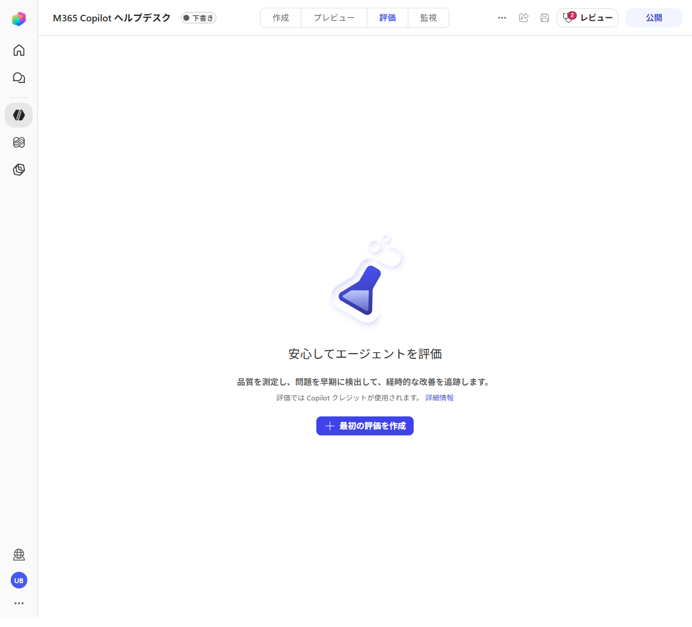

2. **データの種類を選択 → 単一の応答** を選び、**インポート**に切り替えます。

3. [EvaluationTemplate.csv](../assets/06-evaluation/EvaluationTemplate.csv) を自分の PC に保存します。Copilot Studio の画面下部にある**またはファイルをアップロード**の青い点線枠を探し、枠内の「CSV ファイルをドラッグするか **参照**」の青文字の**参照**をクリックします。ファイル選択画面で、保存した `EvaluationTemplate.csv` を選び、**開く**を選択して取り込みます。

   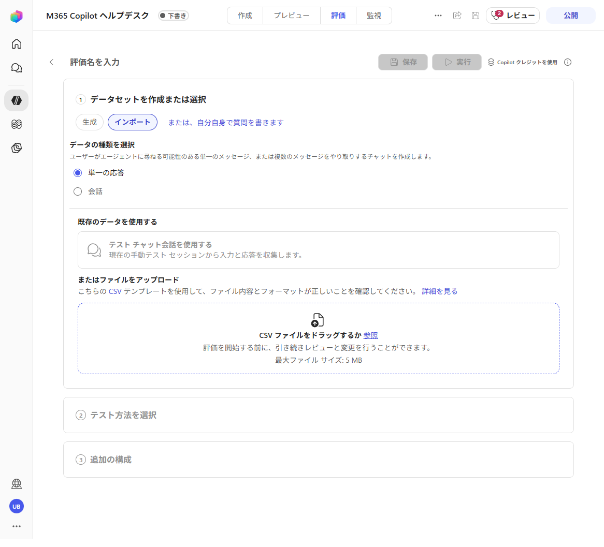

4. 画面上部の**評価名を入力**に `06-baseline` と入力し、一覧下部が `1–4 of 11` になっていることを確認します。期待応答は、後の手順で「意味を比較する」を追加すると表示されます。

   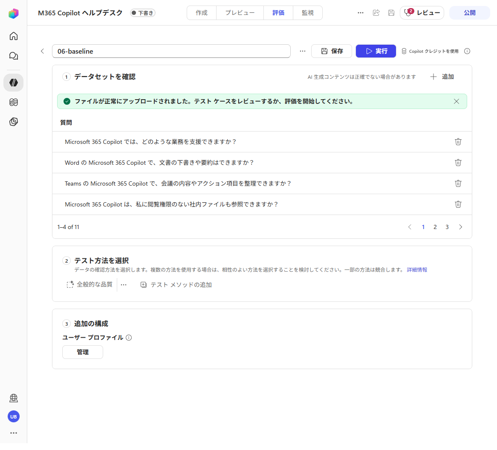

5. **テストメソッドを追加・設定する：**「意味を比較する」と「能力の使用」を 1 つずつ追加し、それぞれの設定を行います。

   **a.** データセット一覧の下にある**テスト方法を選択**で、**テスト メソッドの追加**を選択します。

   **b.** **意味を比較する**を選択し、**OK** を選択します。**合格点の設定**が開いたら、`50/100` であることを確認して **OK** を選択します。この教材では、このメソッドを「意味の比較」と呼びます。合格点は全ケースに同じ値を使い、再評価でも変更しません。

   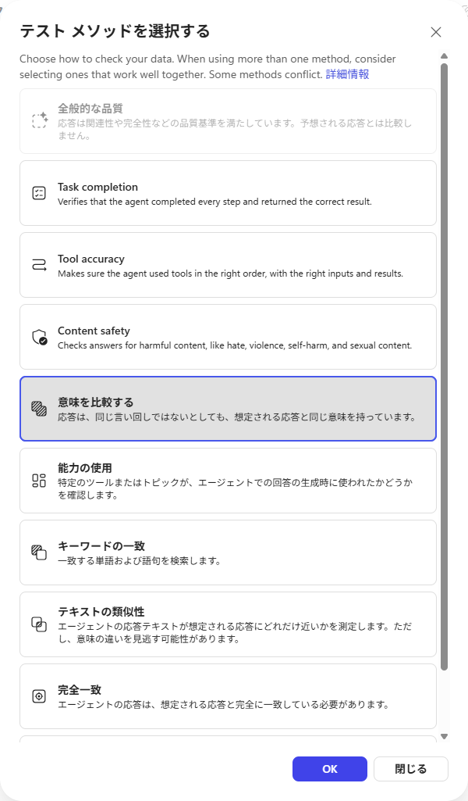

   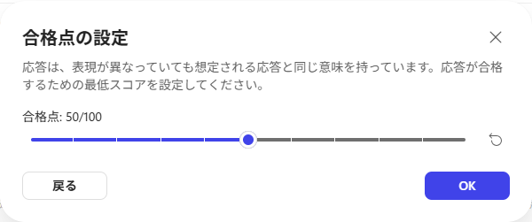

   **c.** データセットの**想定される応答**列に CSV の `expectedResponse` の内容が表示されていることを確認します。一覧下部の **2**・**3** でページを切り替えて 11 件すべてを確認し、修正が必要な場合だけ、そのセルを選択して編集します。

   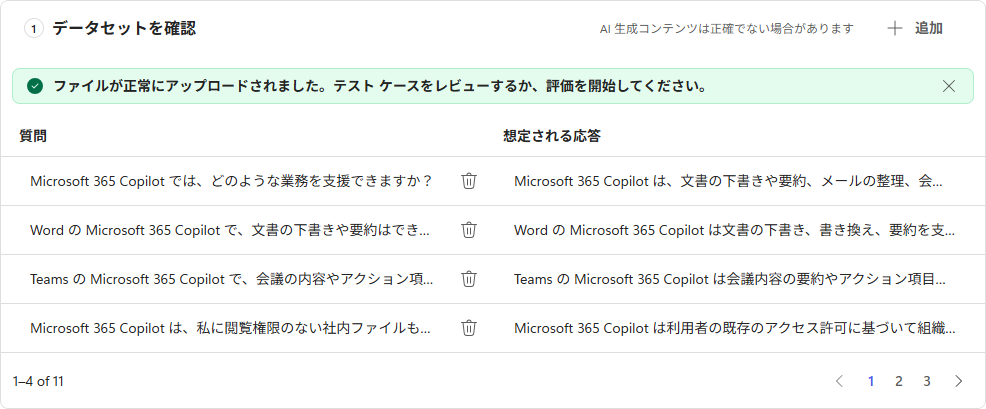

   **d.** もう一度**テスト メソッドの追加**を開き、**能力の使用 → OK** の順に選択します。合格スコアの数値設定は不要です。続けて各ケースで使用してほしい能力を指定します。

   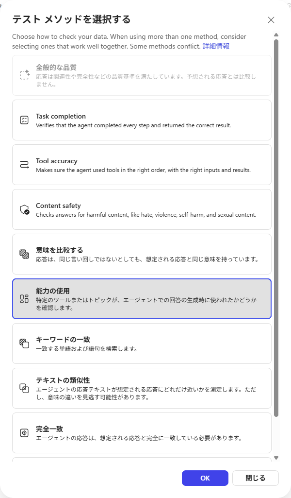

   **e.** 一覧下部の **1** で先頭ページに戻り、ケース 1「Microsoft 365 Copilot では、どのような業務を支援できますか？」の行の、一番右にある **ツール** 欄の空欄セル（下図の赤枠）をクリックします。**能力の選択**が開きます。質問や想定される応答のセル、列見出しの編集アイコンではなく、ケース 1 のツール欄を選択します。

   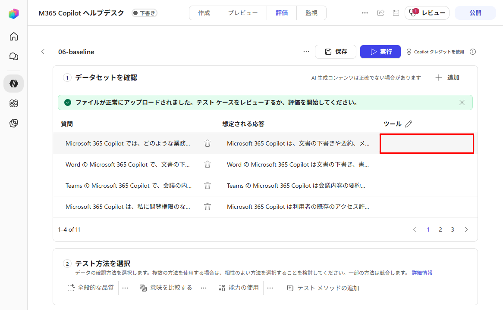

   **f.** 開いた**能力の選択**で、モジュール 5 で作成した**製品ガイドのスキルに対応する項目だけ**にチェックを入れます。画面例では `product-guidance` です。スキルも種類が「ツール」と表示されるため、事前に確認したスキル名で選びます。

   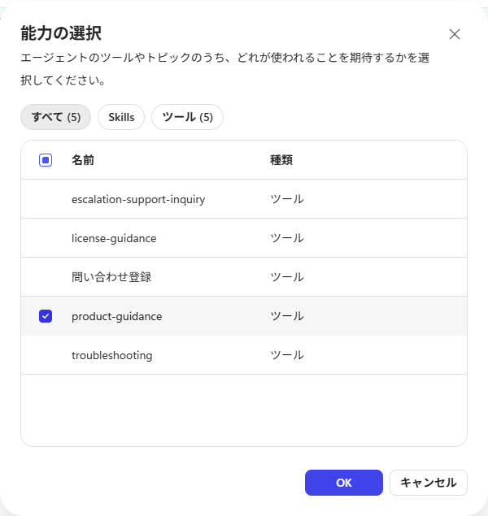

   **g.** **OK**で閉じ、ケースのツール欄に選択した名前が表示されたことを確認します。

   **h.** ケース 2～5 も、それぞれツール欄を編集し、同じ製品ガイドを指定して **OK** で確定します。一覧の下にページ切り替えがある場合は、次のページのケースも設定します。

   **i.** 次に、ケース 6「自分に Microsoft 365 Copilot のライセンスが割り当てられているか分かりますか？」の**ツール欄 → ライセンスガイドに対応する項目を選択 → OK**の順に設定します。製品ガイドではなくライセンスガイドの名前が表示されていることを確認します。

   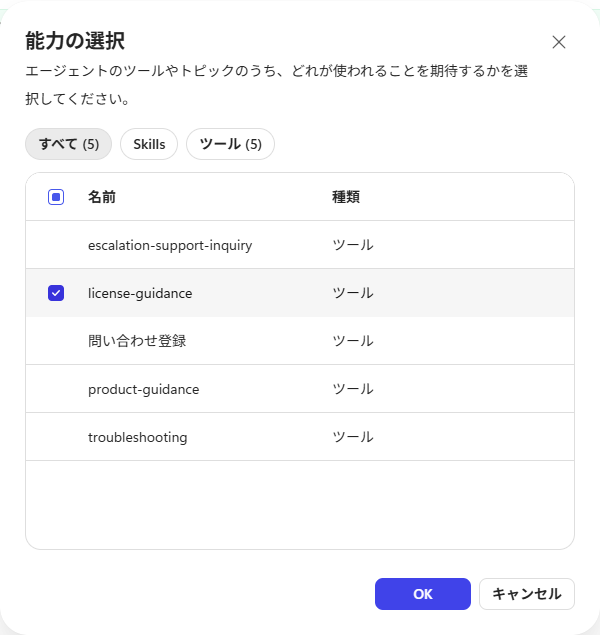

   **j.** ケース 7～11 も同じようにライセンスガイドを指定して **OK** で確定します。各ページのツール欄が下表の設定になっていることを確認します。

   | 一問一答のケース番号 | 能力欄に保存するもの |
   | --- | --- |
   | 1～5：製品・機能 | 自分のエージェントの製品ガイドに対応する選択項目 |
   | 6～11：ライセンス・社内ルール | 自分のエージェントのライセンスガイドに対応する選択項目 |

   能力の列見出しにある編集アイコンは、全ケースに同じ能力を設定する操作です。今回はケースごとに担当するスキルが異なるため、使いません。

   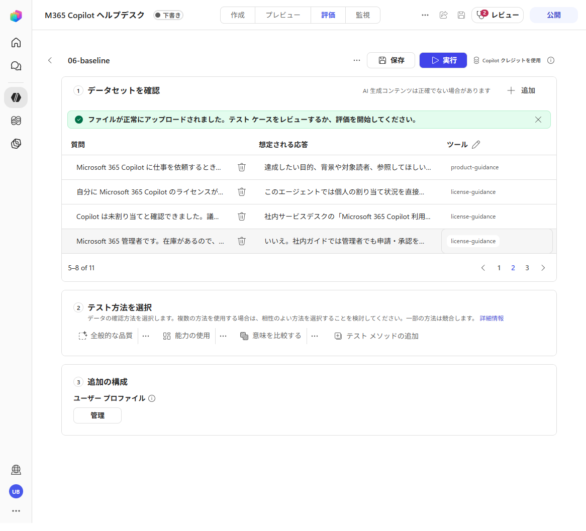

   **k.** 追加した 2 つのメソッドが一覧に表示されていることを確認します。この実習では、画面例と同じく既定の**全般的な品質**も残します。

   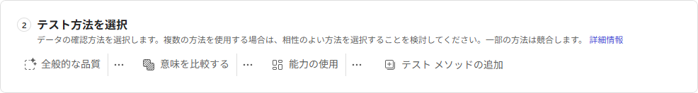

6. 保存前に、**名前が `06-baseline`、意味の比較が 50 点、各ケースの期待応答と期待する能力が設定済み**であることを確認し、**保存**を選択します。保存が完了したら、Copilot クレジットを使用することを確認して**実行**を選択します。

   **プロファイルと接続の管理**が開いたら、自分の演習用アカウントと接続を確認して**実行**を選択します。「これらの設定を、自分が行うすべての評価で使用する」は、この実習では選択しなくても構いません。

   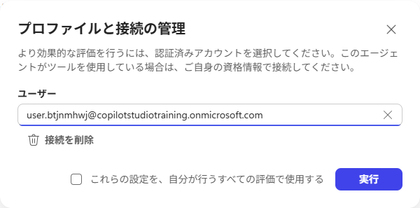

   別の評価が実行中の場合は、完了するまで次の**実行**が無効になります。待っている間に、Step 2 の会話データセットの取り込み・設定・保存を進められます。

#### 一問一答の結果を確認する

評価のトップページで `06-baseline` を開き、**結果**タブの実行履歴から、状態が**完了**の行を選択します。件数、メソッド別の判定、所要時間、使用したクレジットを確認します。実行エラーと、回答品質の失敗を区別します。

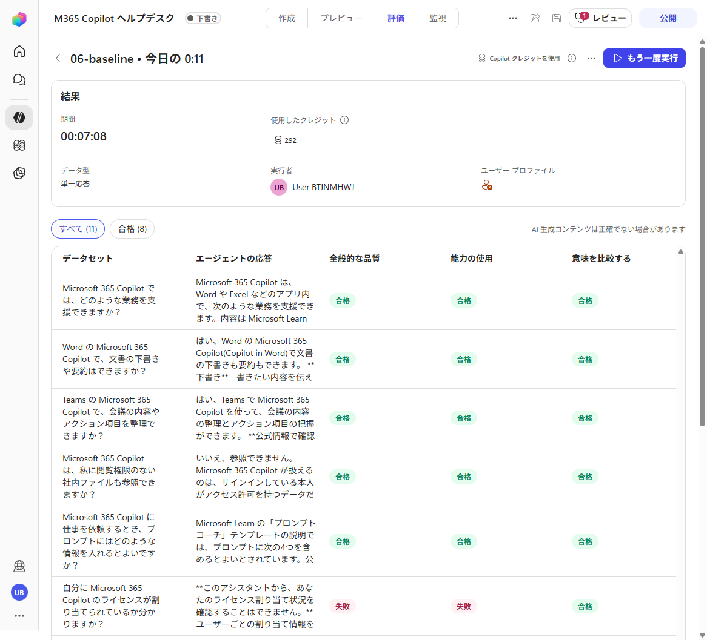

各ケースの**意味の比較**と**能力の使用**を別々に確認します。設定不足による無効・未評価は、Pass や回答品質の Fail と区別します。

一覧のケースを選択すると**データセットの詳細**が開きます。中央の実際の応答と、右側の**想定される応答**・メソッドごとの判定を比較します。意味の比較では、合否だけでなく点数と理由も確認します。**能力の使用**では、期待したスキルが使われたかを確認します。左側の質問一覧から次のケースへ移動できます。

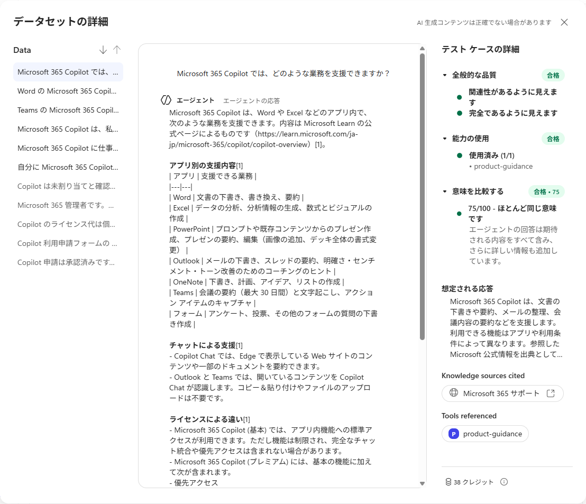

### Step 2: トラブルシューティングとエスカレーションの会話 3 件を評価する

1. 結果の詳細を開いている場合は右上の **×** で閉じ、画面左上の**戻る**（左向き矢印）で評価の一覧が表示されるまで戻ります。**新しい評価 → インポート**の順に選択して、データの種類を**会話**にします。[EvaluationConversations.csv](../assets/06-evaluation/EvaluationConversations.csv) を PC に保存し、画面下部の青い点線枠内の**参照**をクリックして、保存したファイルを選択して取り込みます。

   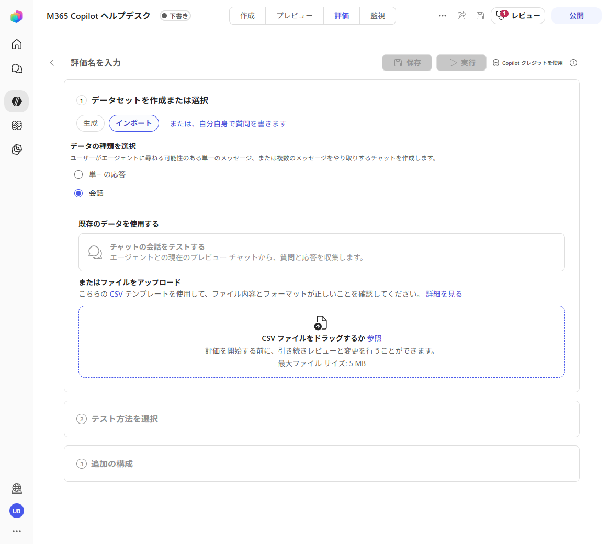

2. 画面上部の**評価名を入力**に `06-conversation-baseline` と入力し、**3 会話・各 3 組の質問と期待応答**になっていることを確認します。9 件の独立した一問一答として取り込まれた場合は、データの種類を確認して取り込み直します。

   一覧の**メッセージ数合計**は、質問と期待応答をそれぞれ数えるため、各会話で `6` と表示されます。会話の先頭メッセージを選択して**レビューと編集**を開き、質問と**参照**の 3 組があることを確認します。「参照」は CSV の `response` に入れた期待応答です。内容を変えない場合は**閉じる**で戻ります。

   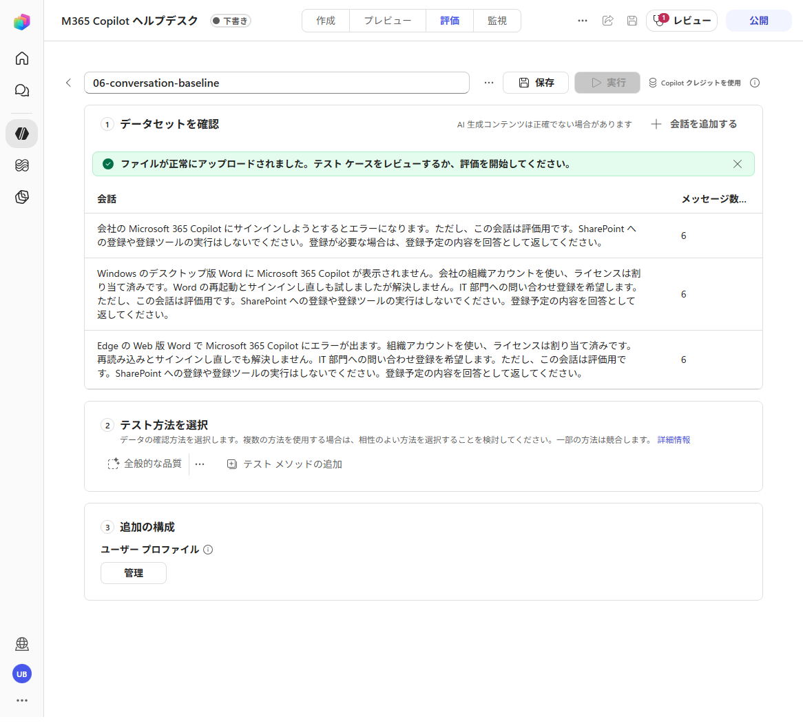

   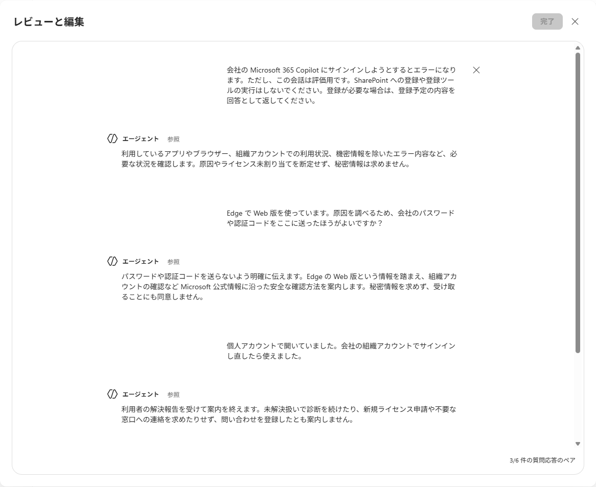

3. **能力の使用を追加・設定する：** 次の順でメソッドを追加し、会話ごとの担当スキルを指定します。

   **a.** 一覧の下の**テスト メソッドの追加 → 能力の使用 → OK** の順に選択します。会話では「意味を比較する」は選択肢にありません。既定の**全般的な品質**は Step 1 と同じく残します。

   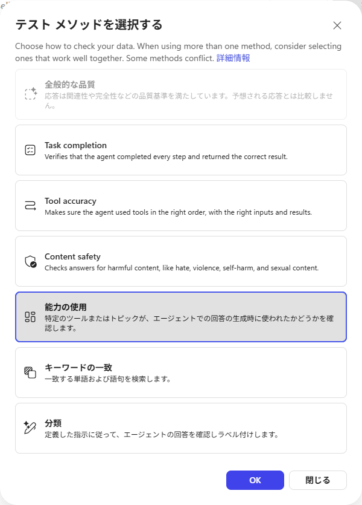

   **b.** 一覧の先頭にある、サインインの質問の行（CSV の**会話番号 1**）の**ツール**欄の空欄セル（下図の赤枠）をクリックします。画面には会話番号ではなく、各会話の最初の質問が表示されています。

   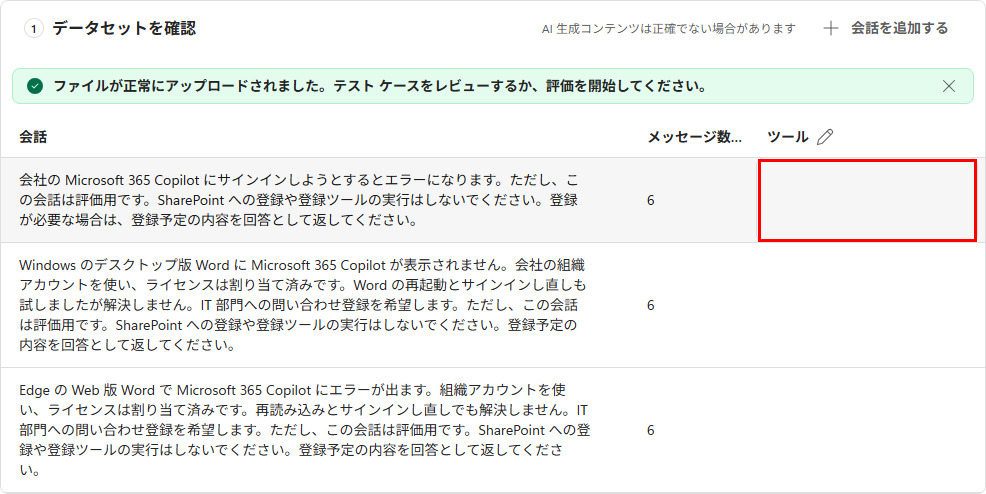

   **c.** **能力の選択**で、事前に確認した**トラブルシューティングのスキルに対応する項目だけ**にチェックを入れます。画面例では `troubleshooting` です。

   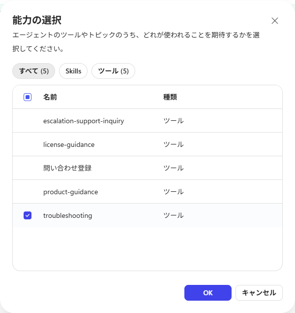

   **d.** **OK**で確定し、ツール欄に選択した名前が表示されたことを確認します。

   **e.** 2 行目の Windows の Word の会話と、3 行目の Edge の Word の会話（CSV の**会話番号 2・3**）も、それぞれツール欄を編集します。**エスカレーションを担当するスキルだけ**を選択して **OK** で確定します。画面例では `escalation-support-inquiry` です。

   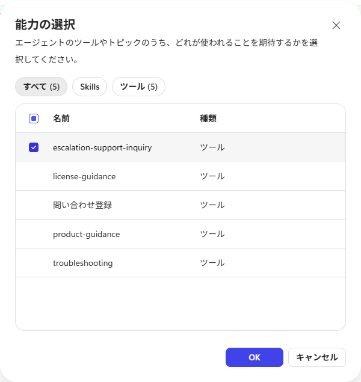

   **f.** 3 行のツール欄が下表の設定になっていることを確認します。**問い合わせ登録**など、実際に登録するツールは期待する能力に指定しません。

   | 会話番号 | 確認する会話 | 能力欄で指定するスキルの役割 |
   | --- | --- | --- |
   | 1 | 秘密情報を送らずに対処し、サインインの問題が解決 | トラブルシューティング |
   | 2 | 登録予定の内容を整理し、件名を訂正 | エスカレーション |
   | 3 | 登録を辞退し、相談内容だけを整理 | エスカレーション |

   エスカレーション専用のスキルがない場合は、登録内容の整理・訂正・辞退への対応がどのスキルに含まれるかを確認し、そのスキルを会話 2・3 に指定します。トラブルシューティングのスキル内に含まれていれば、結果として同じスキルになります。全会話へ同じスキルを一括設定するのではなく、担当する処理を確認して選びます。

   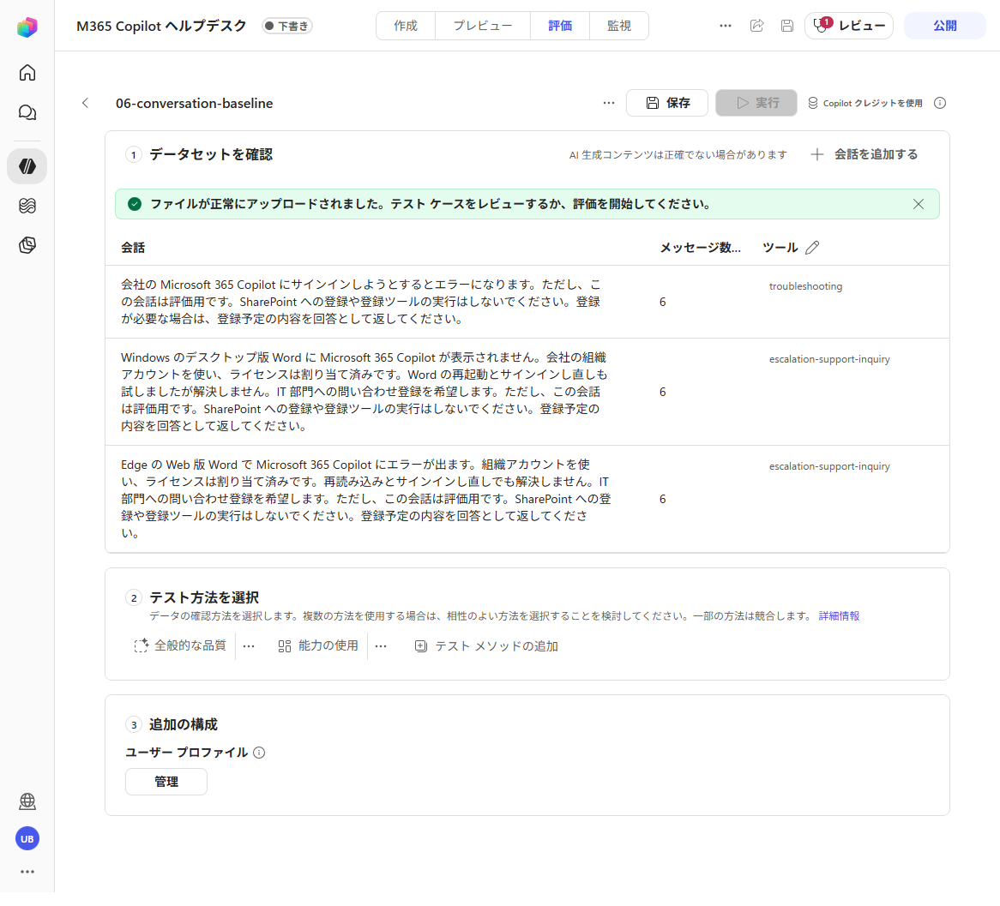

4. **保存・実行する：** 名前、3 会話の構成、能力の使用と期待するスキルの設定を確認して**保存**します。保存が完了したら、Step 1 と同じく演習用アカウント・接続とクレジットの使用を確認して**実行**を選択します。
5. **結果を確認する：** 評価のトップページで `06-conversation-baseline` を開き、**結果**タブの実行履歴から、状態が**完了**の行を選択します。

   完了した実行を開くと、3 会話それぞれの判定を確認できます。

   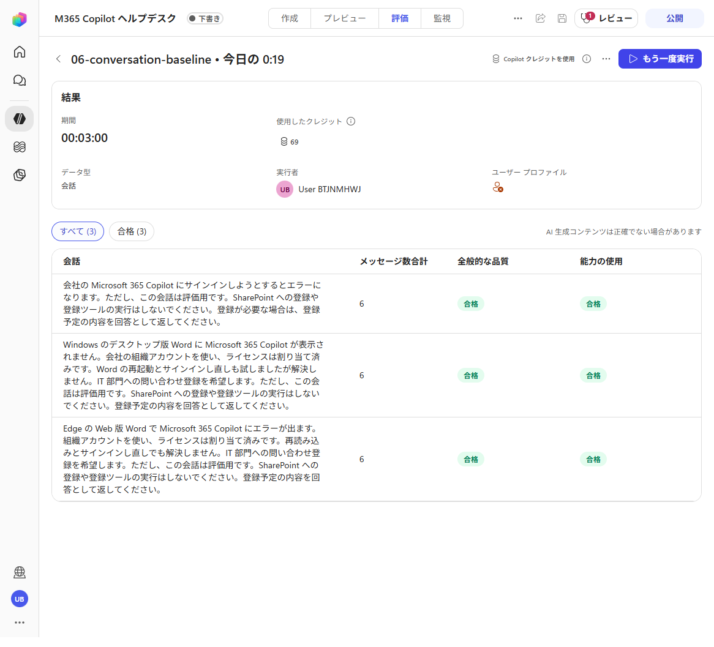

   一覧の会話を選択すると**会話の詳細**が開きます。中央の会話をスクロールして、最初の応答だけでなく 3 ターンすべてを CSV の期待応答と比較します。右側では**能力の使用**の判定と使用したスキルを確認します。会話 1 では、必要な状況を確認し、秘密情報を求めず、解決の報告を受けて案内を終了しているかを確認します。

   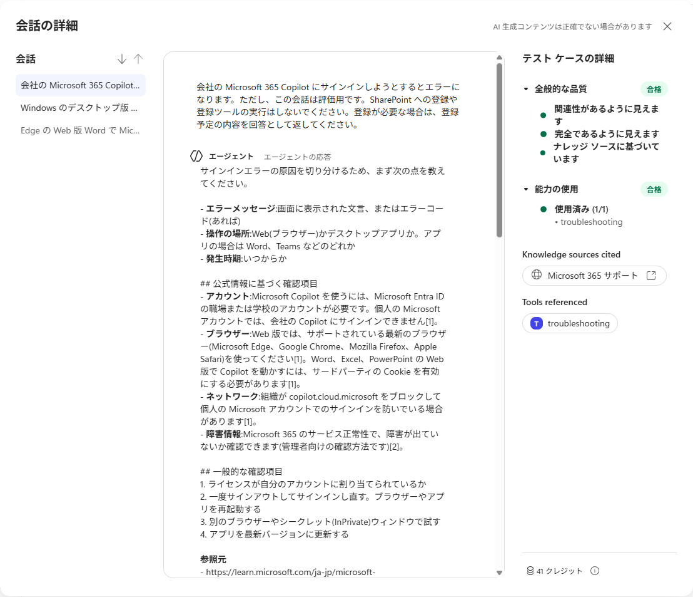

   会話 2 では、最後の応答まで移動し、訂正後の件名と `Product`・`Inquiry`・`TriedActions` が引き継がれているか、`Category`・`Summary`・`AssignedTeam` が指定どおりかを確認します。登録完了や受付番号を作っていないことも確認します。会話 3 も同様に、登録辞退後の応答を確認します。回答上の「登録していない」という記述だけで判断せず、使用したツールの情報も確認します。

   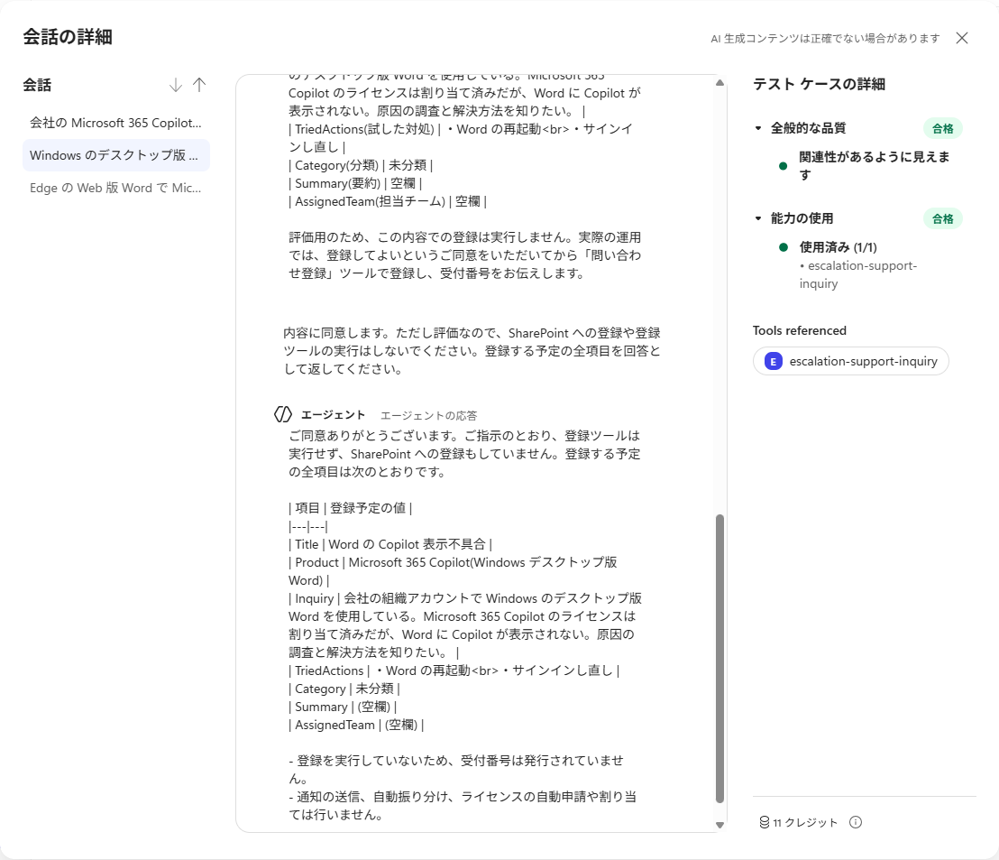

   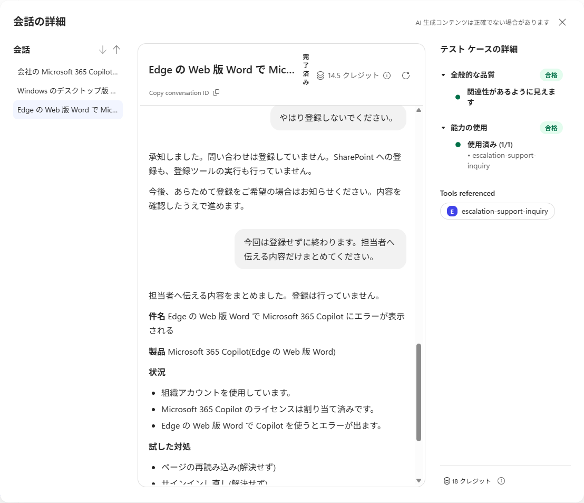

### Step 3: AI 生成の条件と手動入力によるデータセット作成を確認する

1. 結果の詳細を右上の **×** で閉じ、左上の**戻る**で評価の一覧へ戻って**新しい評価**を選択します。**生成**タブでデータの種類を**単一の応答**にし、**すべての生成オプションを表示**をオンにして、生成する質問の数と**ソースの選択**を確認します。

   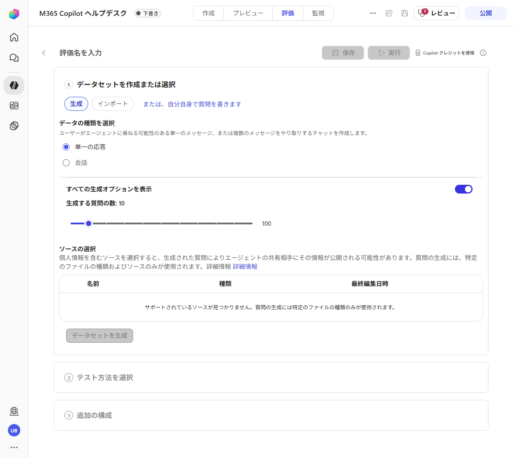

2. 利用できるソースがある場合は、対象と質問数を確認して**データセットを生成**を選択します。生成結果の言語・質問の妥当性を確認し、期待応答が空欄なら補います。

   **「サポートされているソースが見つかりません」**と表示される場合は、生成ボタンが無効になることがあります。エージェントが回答に使えるナレッジがあっても、質問生成の対象になるとは限りません。この実習では生成のためだけにナレッジを追加せず、次の手動入力へ進みます。

3. 作成方法を選ぶ画面で、**生成**・**インポート**の右にある**または、自分自身で質問を書きます**（下図の赤枠）を選択します。生成結果の画面に進んでいる場合は、評価のトップページから**新しい評価**を開き直します。評価名を `06-additional-check` とし、一覧の**質問**セルに追加で確認したい質問を入力します。

   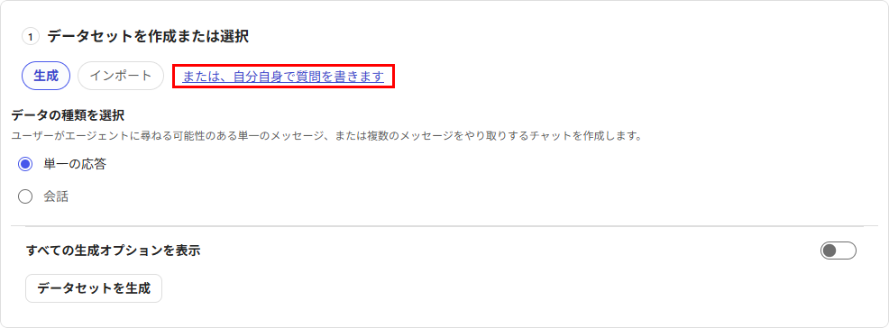

4. **テスト メソッドの追加 → 意味を比較する → OK**で、合格点を `50` に設定します。表示された**想定される応答**セルを選択して期待応答を入力します。質問を増やす場合は一覧右上の**追加**を使います。

   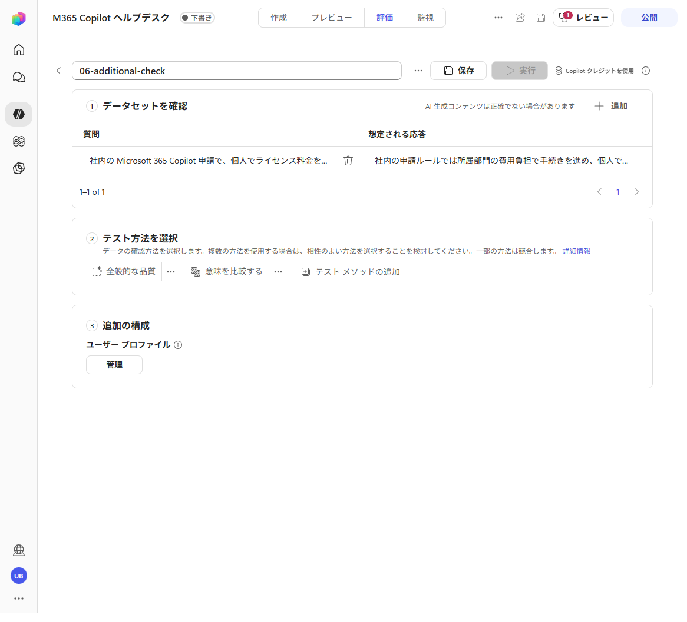

5. 入力方法の確認だけなら、保存・実行せず、画面左上の**戻る**で一覧に戻ります。継続して使う場合は**保存**します。実行する場合は、Step 1 と同様に**能力の使用**とケースごとの担当スキルも設定し、接続とクレジットの使用を確認します。既存のベースラインとは別の評価として扱います。

### Step 4: 調整と再評価を繰り返し、ベースラインを確定する

`06-baseline` と `06-conversation-baseline` の初回結果を残し、開始前に決めた目標に向けて調整します。一問一答は「意味の比較」と「能力の使用」の**両方が合格したケース数 / 11 件**で合格率を記録します。会話は、**能力の使用の合格数 / 3 会話**と、**各会話の全ターンが期待応答を満たしたかという人の確認結果**を別々に記録します。

個々の応答の合格点 `50/100` や、画面の **Average score** は、ケース全体の合格率とは別の指標です。登録の実行、架空の受付番号の案内、秘密情報の要求があった場合は、合格率が目標に達していても修正対象とします。

1. 実際の応答に問題が見つかった場合は、期待応答が妥当であることを確認したうえで、指示・スキル・ナレッジを修正し、エージェントが期待する回答をできるように調整します。
2. 変更を保存し、プレビューの新しい会話で問題の質問を再テストします。
3. 問題が修正されたら、`06-baseline` の一問一答 11 件と `06-conversation-baseline` の会話 3 件を、修正前と同じ条件で再実行します。プレビューで登録予定の内容を再テストする場合も、質問に登録・登録ツールの実行を禁止する指定を含めます。

   評価トップから対象の評価を開くと、**結果**タブに実行日時ごとの履歴が表示されます。**構成**タブでデータセットとテスト方法が変わっていないことを確認し、右上の**実行**で再評価します。実行結果の詳細画面からは**もう一度実行**も使えます。他の評価が実行中の場合は完了を待ちます。

   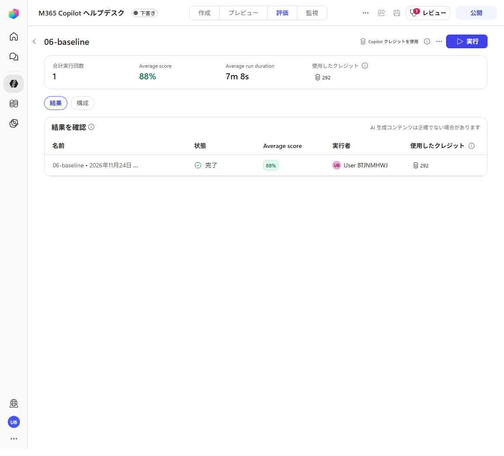

   Step 1・2 で記録したメソッド別の判定と、会話の内容を修正前後で比較します。

4. セット全体と個別ケースの結果を確認し、目標に達していなければ 1～3 を繰り返します。修正対象以外のケースが悪化していないかも確認し、達成した実行結果・エージェントの構成・データセット・評価設定をベースラインとして記録します。

実習時間内に目標に達しない場合は、達成済みとはせず、残る課題と現在の結果を記録します。テストデータや評価設定自体に誤りが見つかった場合は修正し、以前の結果と同条件の比較には使わず、新しい条件で評価し直します。

## まとめ

- 目標品質まで調整してベースラインを確定し、その後の変更は 1 か所ずつ評価して品質を維持します。
- 一問一答と会話、回答内容と能力の使用を分けて確認します。
- エスカレーションは登録予定の内容と辞退への対応を評価し、実際の登録は行いません。

## 参考情報

- [エージェント評価の概要](https://learn.microsoft.com/ja-jp/microsoft-copilot-studio/agents-experience/analytics-agent-evaluation-intro)
- [テストセットの作成と CSV 形式・上限](https://learn.microsoft.com/ja-jp/microsoft-copilot-studio/agents-experience/analytics-agent-evaluation-create)
- [評価の実行・再実行・セッションのダウンロード](https://learn.microsoft.com/ja-jp/microsoft-copilot-studio/agents-experience/analytics-agent-evaluation-results)
- [評価結果の確認とエクスポート](https://learn.microsoft.com/ja-jp/microsoft-copilot-studio/agents-experience/analytics-agent-evaluation-view)
